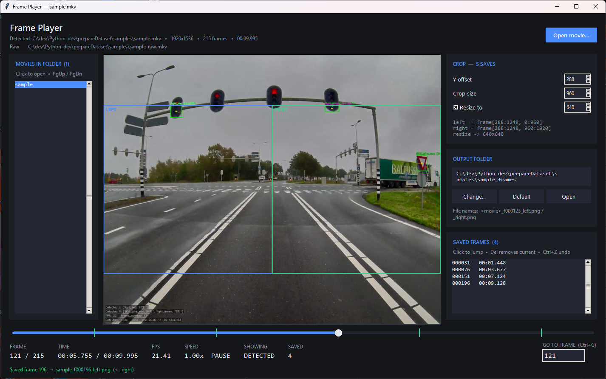
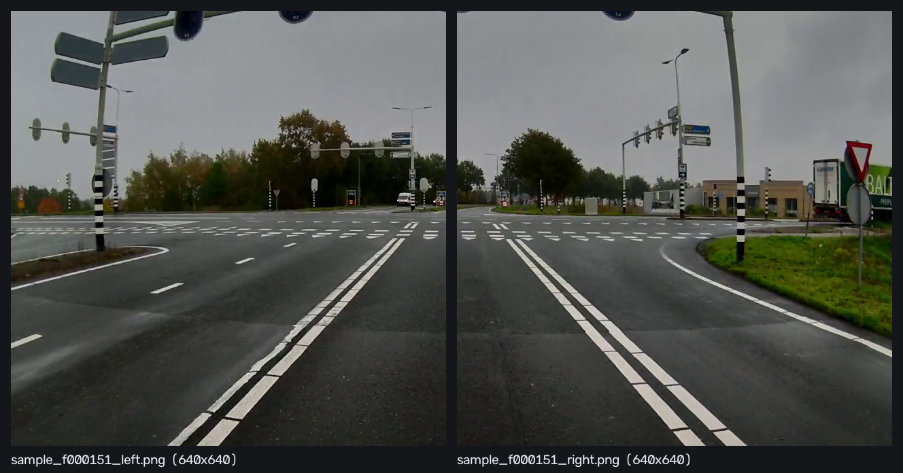
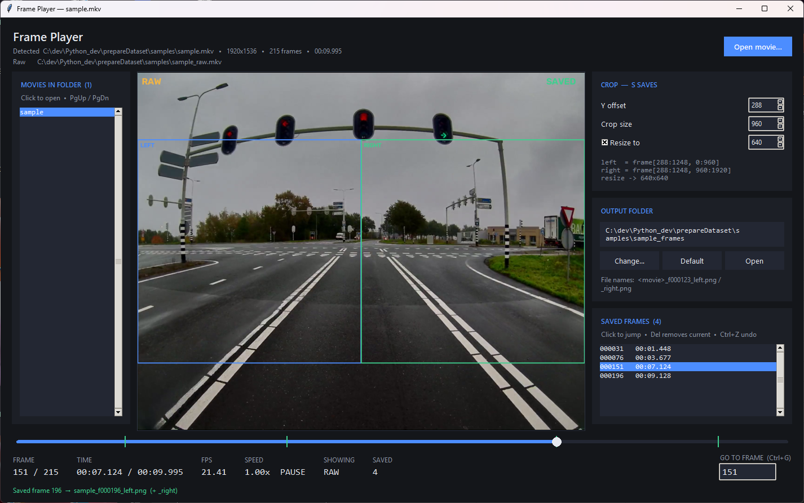

# PrepareDataset

Desktop tools for building image datasets from recorded driving footage:

- **Frame Player** (`framePlayer.py`) — a VLC-style player for paired MKV
  recordings. Browse the movie with detections drawn in, and press **S** to save
  the same frame from the clean (raw) recording as `_left` / `_right` crops.
- **Frame Splitter** (`splitImages.py`) — batch-splits a folder of images into
  `_left` / `_right` crops with the same crop logic.



---

## Quick start

```bash
git clone https://github.com/amirgol64/prepareDataset.git
cd prepareDataset
python -m venv .venv
.venv/Scripts/python.exe -m pip install -r requirements.txt

# try it on the bundled 10-second sample
.venv/Scripts/python.exe framePlayer.py samples/sample.mkv
```

Requires Python 3.9+ (tested with 3.11) with `tkinter` (bundled with the standard Windows
installer). Dependencies: `av` (PyAV), `opencv-python`, `numpy`.

---

## Frame Player

### Files it expects

Each recording is a **pair** of movies in the same folder:

| File | Content | Used for |
| --- | --- | --- |
| `name.mkv` | detected — boxes and labels drawn in | what you watch |
| `name_raw.mkv` | raw — the same frames without drawings | what gets saved |

Open either file (button, **Ctrl+O**, or as a command-line argument); the
partner is found automatically. Both files must hold the same frames in the same
order: the app compares frame count, size and frame rate on open and warns if
they differ. Without a `_raw` file the movie still plays, but saving is disabled.

All movies in the folder are listed on the left; click one or use
**PgUp / PgDn** to switch.

### Keyboard

| Key | Action |
| --- | --- |
| ← / → | 1 frame back / forward |
| Shift + ← / → | 10 frames |
| Ctrl + Shift + ← / → | 100 frames |
| Home / End | First / last frame |
| Space | Play / pause |
| `[` / `]` | Slower / faster (0.25x – 4x) |
| **S** | Save the current frame from the raw movie |
| Delete | Delete the current frame's saved files |
| Ctrl+Z | Undo the last save of this session |
| Tab | Show the raw movie instead of the detected one |
| Ctrl+G | Go to a frame number |
| PgUp / PgDn | Previous / next movie in the folder |
| Ctrl+O | Open a movie |

You can also click or drag the seek bar, and click a row in the saved-frames
list to jump to it.

### Saving frames

**S** reads the current frame from the **raw** movie (also while the detected
one is on screen), crops it and writes two PNGs:

```
<output folder>/<movie>_f000151_left.png
<output folder>/<movie>_f000151_right.png
```



- **Frame numbers start at 1**, matching the `Frame_number` burned into the
  recordings.
- **Crop:** set **Y offset**, **Crop size** and optional **Resize to** in the
  Crop panel; the left / right boxes are drawn live on the video and turn red if
  they don't fit the frame. The defaults (288 / 960 / 640) take the two
  960-pixel halves of a 1920x1536 frame, centred vertically, resized to 640x640.
- **Output folder:** `<movie>_frames/` next to the movie, or any folder you pick
  with **Change…**.
- Saved frames show **SAVED** on the video, a green tick on the seek bar and a
  row in the saved-frames list. Frames saved in earlier sessions are found on
  disk when the movie opens.
- Saving a frame that already exists is skipped. **Delete** and **Ctrl+Z**
  remove files permanently (not to the Recycle Bin); pressing **S** again
  recreates them.

Press **Tab** to check what will be saved — the raw frame, without detections:



### Playback

Playback follows each frame's own timestamp, so variable-frame-rate recordings
play at real speed; when decoding can't keep up at high speed, frames are skipped
rather than slowed down. Arrow keys, the seek bar and go-to work while playing.

### Remembered between sessions

The last movie (reopened when the app starts without an argument), the frame
position in each movie, crop settings, output folder, speed and window size are
saved in:

```
%APPDATA%\FramePlayer\settings.json
```

Delete that file to go back to the defaults.

### Why PyAV and not OpenCV

On these MKV recordings (H.264, variable frame rate, a keyframe every 250
frames) OpenCV's seeking returns the wrong frame, can take over 30 seconds, and
silently skips the first 250 frames. The player therefore indexes each file with
PyAV on open (about half a second) and decodes any frame exactly from the
keyframe before it. Recent frames are cached at display size, so stepping
backward stays instant. `tools/probe_video.py` reproduces the OpenCV problem on
your own files.

---

## Frame Splitter

Batch-splits a folder of side-by-side frames into `_left` / `_right` images with
a live preview of the crop.

```bash
.venv/Scripts/python.exe splitImages.py
```

Select an input folder and an output folder, adjust the crop, check the preview,
then press **Start splitting**.

Per image (defaults `CROP_Y_OFF=60`, `CROP_SIZE=960`, `RESIZE_TO=640`):

```python
crop_y1 = CROP_Y_OFF + CROP_SIZE
left    = frame[CROP_Y_OFF:crop_y1,         0:CROP_SIZE]
right   = frame[CROP_Y_OFF:crop_y1, CROP_SIZE:2 * CROP_SIZE]
if RESIZE:
    left  = cv2.resize(left,  (RESIZE_TO, RESIZE_TO))
    right = cv2.resize(right, (RESIZE_TO, RESIZE_TO))
```

| Setting | Default | Meaning |
| --- | --- | --- |
| Crop Y offset | `60` | Top edge of the crop region, in pixels |
| Crop size | `960` | Width and height of each half before resizing |
| Expected input size | `1920x1080` | Frames of any other size are skipped and logged |
| Resize to | `640` | Square output size; disable to keep the crop size |
| Output format | `PNG` | `PNG` or `JPG` (quality 95) |
| Include subfolders | off | Recurse and mirror the folder structure |

- **Already-split frames** (width exactly twice the height, e.g. 1280x640) are
  halved down the middle without cropping.
- Output names add `_left` / `_right` to the input name:
  `frame_0421.png` → `frame_0421_left.png`, `frame_0421_right.png`.
- Input extensions: `.png`, `.jpg`, `.jpeg`, `.bmp`, `.webp`, `.tif`, `.tiff`.
- Settings are remembered in `%APPDATA%\FrameSplitter\settings.json`.

---

## Repository layout

| Path | Content |
| --- | --- |
| `framePlayer.py` | Frame Player |
| `splitImages.py` | Frame Splitter, plus the crop / style helpers both apps share |
| `samples/` | 10-second sample pair (`sample.mkv`, `sample_raw.mkv`, ~6 MB each) |
| `tools/probe_video.py` | Codec / frame-count / OpenCV seek-accuracy check for a movie pair |
| `tools/make_sample.py` | Cuts a short re-encoded sample pair from a recording |
| `docs/images/` | Screenshots used in this README |
| `plan.md` | Design decisions and development log |
